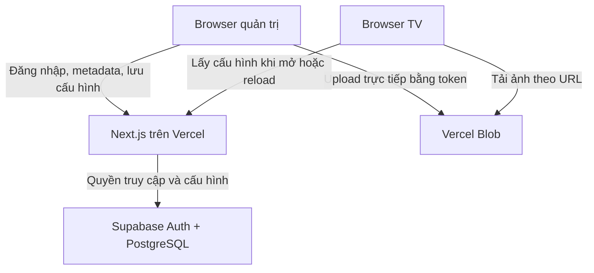

# Signage TV — Kế hoạch sản phẩm và triển khai

**Phiên bản:** 1.0  
**Ngày:** 13/11/2026  
**Trạng thái:** Planning; chưa thiết kế giao diện, chưa triển khai ứng dụng.  
**Mục đích:** Đưa vào thư mục project hoặc upload vào ChatGPT Project để làm tài liệu yêu cầu và đầu vào cho lập trình viên/AI.

## 1. Mục tiêu sản phẩm

Xây dựng một website quản lý hình ảnh cho nhiều nhà hàng và nhiều người dùng. Người quản lý đăng nhập, upload hình, gán nội dung cho từng TV và lưu cấu hình. TV sử dụng browser để mở một đường dẫn cố định, ví dụ `/XLC/1`.

TV lấy nội dung khi mở hoặc reload trang. Sau khi đã tải, TV tiếp tục hiển thị ảnh hoặc chạy slideshow bằng bộ hẹn giờ cục bộ. Việc thay đổi nội dung trên website không chủ động cập nhật TV đang mở.

Một người có thể quản lý nhiều nhà hàng. Một nhà hàng có thể có nhiều người quản lý và nhiều TV. Dữ liệu quản trị phải được phân quyền theo từng nhà hàng.

## 2. Các yêu cầu đã chốt

| ID | Yêu cầu | Tiêu chí chính |
| --- | --- | --- |
| REQ-01 | React + Next.js | Một project Next.js sử dụng React cho giao diện |
| REQ-02 | Hỗ trợ nhiều người dùng | Đăng nhập; chỉ quản lý nhà hàng được cấp quyền |
| REQ-03 | Hỗ trợ nhiều nhà hàng | Tách thư viện ảnh, TV và quyền quản lý |
| REQ-04 | Upload hình dung lượng lớn | Người dùng upload ngay trên website |
| REQ-05 | Nội dung riêng cho từng TV | TV có URL cố định theo nhà hàng và mã TV |
| REQ-06 | Cập nhật thủ công | TV chỉ lấy cấu hình mới khi mở/reload trang |
| REQ-07 | Xoay nội dung | Cấu hình riêng 0°, 90°, 180°, 270° cho từng TV |
| REQ-08 | TV ngang và dọc | Trang tổng quan thể hiện đúng tỷ lệ hướng treo |
| REQ-09 | Trang tổng quan | Xem toàn bộ TV của nhà hàng trong một trang |
| REQ-10 | Preview riêng | Click vào TV để mở preview riêng TV đó |
| REQ-11 | Đổi tên TV | Đổi tên hiển thị mà không thay đổi mã hoặc URL |
| REQ-12 | Có thể deploy Vercel | Không phụ thuộc ổ đĩa hoặc tiến trình server cục bộ |
| REQ-13 | Chỉ lập kế hoạch ở thời điểm này | Tài liệu này không phải yêu cầu bắt đầu code/deploy |

### 2.1. Phương án đã trao đổi và được đưa vào bản kế hoạch

- File ảnh lưu tại Vercel Blob; database lưu metadata và cấu hình.
- Có ảnh cố định và playlist nhiều ảnh với thời gian chuyển.
- Có chế độ hiện trọn ảnh (`contain`) hoặc lấp đầy khung (`cover`, có thể cắt mép).
- Trang quản trị, preview và trang phát TV nằm trong cùng ứng dụng.
- Trang tổng quan phản ánh cấu hình đã lưu, không khẳng định trạng thái TV thực tế.

### 2.2. Những mặc định được đề xuất, chưa phải quyết định của chủ dự án

| Hạng mục | Mặc định đề xuất | Lý do / hệ quả |
| --- | --- | --- |
| Ngôn ngữ code | TypeScript | Dùng chung kiểu dữ liệu giữa quản trị và player |
| Database | PostgreSQL trên Supabase | Gộp database và nhà cung cấp đăng nhập |
| Đăng nhập | Supabase Auth, email/password | Không tự xây hệ thống lưu mật khẩu |
| Giao diện quản trị | Tiếng Việt, responsive | Phù hợp người vận hành hiện tại |
| Vai trò | Owner và Editor | Đủ cho quản lý cửa hàng và nhân viên chỉnh nội dung |
| Link phát TV | Public, chỉ đọc | Giữ cách mở `/XLC/1` đơn giản; ai biết link có thể xem |
| Loại nội dung | Ảnh menu/quảng cáo công khai | Không dùng mặc định public cho tài liệu nội bộ |
| Khung TV | Ngang 16:9, dọc 9:16 | Có thể mở rộng tỷ lệ khác sau |
| Dung lượng ảnh tối đa | 25 MiB/file | Giới hạn của ứng dụng, không phải giới hạn Vercel Blob |
| Giới hạn pixel | 16 megapixel/file | Hỗ trợ ảnh 4K thông dụng và hạn chế tải bộ nhớ quá lớn |
| Playlist | Tối đa 20 ảnh/TV, 5–300 giây/ảnh | Điểm khởi đầu để thử trên thiết bị thật |
| Hiệu ứng chuyển | Chuyển trực tiếp | Giảm yêu cầu đồ họa cho browser TV |
| Tạo tài khoản ban đầu | Người vận hành hệ thống tạo | Chưa cần mở đăng ký công khai trong V1 |

Nếu cần nội dung phát riêng tư, phải đổi thiết kế truy cập và lưu trữ trước khi đưa dữ liệu thật lên. URL khó đoán và `noindex` không phải cơ chế bảo mật.

## 3. Phạm vi phiên bản đầu

### 3.1. Chức năng V1

1. Đăng nhập, đăng xuất và khôi phục mật khẩu.
2. Chọn nhà hàng trong danh sách được cấp quyền.
3. Tạo TV, đổi tên TV, sắp xếp thứ tự và ngừng sử dụng TV.
4. Upload nhiều ảnh, xem tiến trình, xem thư viện và lưu trữ ẩn ảnh cũ.
5. Gán một ảnh hoặc nhiều ảnh cho TV; thay đổi thứ tự và thời lượng.
6. Cấu hình hướng treo, góc xoay nội dung và cách căn ảnh.
7. Xem tổng quan các TV ngang/dọc, với tên và thumbnail của nội dung đã lưu.
8. Click TV để mở preview riêng; có nút rõ ràng để chuyển sang chỉnh sửa.
9. Lưu cấu hình thành một phiên bản hoàn chỉnh.
10. Mở URL phát trên TV; lấy phiên bản mới khi reload.
11. Quản lý thành viên đã có tài khoản và quyền Owner/Editor.
12. Deploy thử nghiệm rồi kiểm tra thực tế trên TV dự kiến sử dụng.

### 3.2. Chưa thuộc V1

- Tự đẩy nội dung, polling, WebSocket, Server-Sent Events hoặc Supabase Realtime cho player.
- Heartbeat, trạng thái online/offline, ảnh chụp màn hình hoặc xác nhận TV đã cập nhật.
- Nút điều khiển reload TV từ xa, bật/tắt TV từ website.
- Ứng dụng Android/iOS, kiosk native hoặc phần mềm cài trên TV.
- Video, âm thanh, YouTube, livestream, lịch phát theo giờ.
- Đồng bộ thời điểm chuyển ảnh giữa nhiều TV.
- Trình thiết kế menu, sửa ảnh hoặc tạo hình bằng AI.
- Sơ đồ mặt bằng nhà hàng có kéo thả vị trí TV chính xác.
- Bảo đảm hoạt động sau khi mất điện/mất mạng và mở lại browser.
- Thu phí thuê bao, thanh toán, quản lý hóa đơn SaaS.
- Đăng ký công khai tự phục vụ và hệ thống mời thành viên qua email hoàn chỉnh.

## 4. Kiến trúc tổng thể



| Thành phần | Trách nhiệm |
| --- | --- |
| React trong Next.js | Trang quản trị, form, tổng quan, preview, player |
| Next.js Route Handlers | Kiểm tra quyền, cấp token upload, đọc/lưu cấu hình |
| Supabase Auth | Tài khoản, xác thực và session của người quản trị |
| PostgreSQL | Nhà hàng, thành viên, TV, asset, phiên bản playlist |
| Vercel Blob | Lưu file ảnh với đường dẫn bất biến |
| Browser TV | Giữ snapshot cấu hình trong bộ nhớ, hiển thị và chuyển ảnh |

Next.js hỗ trợ Route Handlers trong App Router. Cần kiểm tra cấu hình caching đúng với phiên bản Next.js được chọn khi triển khai. [S1]

Không cần tách backend thành dịch vụ riêng ở V1. Không lưu file upload vào thư mục `public/uploads` hoặc filesystem của Vercel để dùng lâu dài.

### 4.1. Địa chỉ local và production

| Môi trường | URL minh họa |
| --- | --- |
| Browser trên máy phát triển | `http://localhost:9090/XLC/1` |
| TV cùng mạng với máy phát triển | `http://192.168.1.100:9090/XLC/1` |
| Production | `https://<ten-mien>/XLC/1` |

`localhost` trên TV trỏ tới chính TV. Để thử từ TV qua mạng LAN, server phát triển phải lắng nghe trên giao diện mạng phù hợp và firewall phải cho phép cổng 9090. IP trong bảng chỉ là ví dụ.

## 5. Mô hình người dùng và phân quyền

Đơn vị phân tách dữ liệu là **nhà hàng** (`restaurant`). V1 chưa cần tầng công ty/chuỗi/chi nhánh riêng. Nếu một thương hiệu có nhiều địa điểm, mỗi địa điểm được tạo thành một restaurant với mã riêng.

| Thao tác trong nhà hàng | Owner | Editor |
| --- | --- | --- |
| Xem tổng quan, thư viện và preview | Có | Có |
| Upload và gán ảnh | Có | Có |
| Đổi tên, xoay, lưu nội dung TV | Có | Có |
| Thêm TV | Có | Có |
| Ngừng sử dụng TV | Có | Không |
| Đổi tên nhà hàng | Có | Không |
| Thêm thành viên đã có tài khoản | Có | Không |
| Đổi quyền hoặc gỡ thành viên | Có | Không |
| Xóa dữ liệu vĩnh viễn | Ngoài V1 | Ngoài V1 |

Quyền thuộc từng membership. Cùng một tài khoản có thể là Owner của XLC và Editor của KBM.

### 5.1. Quy tắc bắt buộc

- Mọi thao tác quản trị kiểm tra session hợp lệ và membership ở server.
- Luôn kiểm tra TV, ảnh và playlist cùng thuộc restaurant đang thao tác.
- Không tin `restaurant_id`, role, owner hoặc user ID do browser tự gửi.
- Khi dùng Supabase, áp dụng cả grants và Row Level Security (RLS); khóa đặc quyền chỉ ở server. [S2]
- Không lấy đối tượng user từ cookie/session chưa xác minh làm bằng chứng phân quyền. Dùng API xác minh theo hướng dẫn SSR hiện hành. [S3]
- Không cho gỡ hoặc hạ quyền Owner cuối cùng; kiểm tra trong transaction để tránh race condition.
- Kiểm tra quyền ở endpoint và ở thao tác ghi dữ liệu; không chỉ ẩn nút trên UI.
- Không cung cấp endpoint liệt kê toàn bộ tài khoản hệ thống cho Owner nhà hàng.

### 5.2. Khởi tạo và quản lý thành viên

Người vận hành tạo restaurant và Owner đầu tiên bằng quy trình quản trị có kiểm soát. Tài khoản khác được tạo qua nhà cung cấp Auth. Owner có thể nhập chính xác email tài khoản đã tồn tại để thêm vào nhà hàng; server chỉ trả kết quả cần thiết, không lộ danh sách tài khoản.

Các hành động tạo tài khoản, reset mật khẩu và thêm thành viên phải được rate limit và ghi lại. Việc mời người mới bằng email có thể bổ sung sau; không cần gửi email thủ công trong giai đoạn lập kế hoạch này.

### 5.3. Quyền đọc của TV

Theo mặc định đề xuất, TV không đăng nhập bằng tài khoản Owner/Editor. Endpoint phát public chỉ trả dữ liệu đủ để trình chiếu: tên TV, hướng, góc xoay, playlist, URL ảnh và phiên bản.

Không trả email, membership, toàn bộ thư viện ảnh, upload token hoặc khóa bí mật. Quyền public xem ảnh menu không kéo theo quyền đọc dữ liệu quản trị. Nếu sử dụng khóa DB đặc quyền để đọc manifest, đặt trong module server-only với truy vấn cố định, dữ liệu trả về theo allowlist.

Vercel Blob có chế độ public/private. V1 đề xuất public cho ảnh quảng cáo công khai; file public có thể xem bởi người có URL, kể cả sau khi ẩn khỏi thư viện. [S5]

## 6. Các trang và đường dẫn

| Trang | URL dự kiến | Hành vi |
| --- | --- | --- |
| Đăng nhập | `/login` | Email/password |
| Khôi phục mật khẩu | `/forgot-password` | Gửi yêu cầu qua Auth |
| Callback đăng nhập/khôi phục | `/auth/callback` | Xử lý luồng Auth |
| Chọn nhà hàng | `/manage` | Chỉ hiện nhà hàng có membership |
| Tổng quan TV | `/manage/XLC/tvs` | Các khung TV ngang/dọc |
| Chỉnh sửa TV | `/manage/XLC/tvs/1` | Tên, cấu hình, playlist |
| Preview riêng | `/manage/XLC/tvs/1/preview` | Hiển thị một TV |
| Thư viện ảnh | `/manage/XLC/media` | Upload, chọn và ẩn ảnh |
| Thành viên | `/manage/XLC/members` | Owner quản lý quyền |
| Cài đặt nhà hàng | `/manage/XLC/settings` | Tên hiển thị, thông tin cơ bản |
| Trang phát TV | `/XLC/1` | Không có giao diện quản trị |

### 6.1. Quy tắc định danh

- `restaurant.id`: UUID nội bộ.
- `restaurant.slug`: mã đường dẫn, ví dụ `XLC`; duy nhất toàn hệ thống, so sánh không phân biệt hoa thường.
- `tv.id`: UUID nội bộ.
- `tv.screen_number`: số nguyên dương cố định trong một nhà hàng, ví dụ `1`.
- `tv.name`: tên tự do, ví dụ `Menu nước – Quầy bên trái`.
- Đổi `tv.name` không đổi `screen_number`, UUID hoặc URL.
- V1 không cho đổi slug nhà hàng từ UI; không tái sử dụng số của TV đã ngừng sử dụng.
- Cấp số TV trong transaction từ bộ đếm của restaurant; tránh hai người tạo trùng số cùng lúc.
- Dành riêng các slug như `api`, `manage`, `auth`, `login`, `forgot-password`, `_next` và các tên hệ thống khác.
- Chuẩn hóa `/xlc/1` về URL chuẩn hoặc resolve không phân biệt hoa thường; không tạo hai nhà hàng XLC/xlc.

Hai TV vật lý cùng mở `/XLC/1` sẽ phát cùng nội dung. V1 chưa ràng buộc link với một thiết bị cụ thể.

## 7. Hành vi của từng màn hình

### 7.1. Tổng quan TV của nhà hàng

- Hiển thị grid responsive chứa tất cả TV đang sử dụng.
- TV ngang dùng khung 16:9; TV dọc dùng khung 9:16.
- Từng card có tên, mã TV, thumbnail, số ảnh, góc xoay và lần lưu gần nhất.
- Với playlist, thumbnail mặc định là ảnh đầu tiên; có thể hiển thị số thứ tự và số ảnh.
- Click card mở preview riêng; nút `Chỉnh sửa` là hành động riêng.
- Có thao tác copy link phát và đổi thứ tự các TV trên trang quản trị.
- Không mở một iframe/player chạy nền cho mỗi card; dùng thumbnail để tránh tải toàn bộ playlist của mọi TV.
- Hiển thị nhãn `Nội dung đã lưu` cùng nhắc nhở `Reload browser trên TV để áp dụng thay đổi`.
- Không hiển thị `TV đang online`, `Đã đồng bộ` hoặc `Đang phát phiên bản mới nhất` khi chưa có bằng chứng từ thiết bị.

Trang này là tổng quan danh sách màn hình, không phải bản đồ bố trí vật lý trong tiệm.

### 7.2. Chỉnh sửa TV

Các nhóm điều khiển:

| Nhóm | Trường / thao tác |
| --- | --- |
| Thông tin | Tên TV, mã cố định, copy URL |
| Hướng hiển thị | Ngang/dọc, góc xoay 0/90/180/270 |
| Căn ảnh | Hiện trọn ảnh / lấp đầy; nền mặc định đen |
| Nội dung | Chọn ảnh đã upload hoặc upload mới |
| Playlist | Kéo đổi thứ tự, thời gian từng ảnh, bỏ ảnh khỏi playlist |
| Xem trước | Preview nháp ngay trong form |
| Lưu | `Lưu cấu hình`; lưu thành công mới đổi phiên bản trên server |

Form có state nháp trên browser. Rời trang khi có thay đổi chưa lưu cần cảnh báo. V1 không cần lưu bản nháp lâu dài vào database.

Đổi tên là cập nhật metadata, không bắt buộc tạo phiên bản playlist mới. Thay đổi cấu hình phát phải lưu nguyên khối. Sau khi lưu, tổng quan và preview riêng phản ánh phiên bản mới; TV đang mở vẫn giữ phiên bản đã tải.

### 7.3. Preview riêng

- Chỉ hiển thị một TV; có tên, hướng treo và phiên bản đang xem.
- Mặc định đọc phiên bản đã lưu mới nhất khi mở trang.
- Có thể chạy slideshow, tạm dừng, chọn ảnh để kiểm tra và xem toàn màn hình nếu browser hỗ trợ.
- Preview trong form được ghi rõ `Bản nháp`; preview riêng ghi `Đã lưu`.
- Dùng chung component trình chiếu, tính tỷ lệ và căn ảnh với trang phát TV.
- Không cần tự cập nhật từ những phiên quản trị khác; người dùng có thể tải lại preview.
- Không gọi đây là hình ảnh trực tiếp từ TV. Không biết thiết bị thật đang ở slide nào.

### 7.4. Trang phát trên TV

- Nội dung phủ viewport, nền đen, không menu quản trị, không thanh cuộn do ứng dụng tạo.
- Một ảnh: giữ nguyên cho đến khi đóng/reload hoặc browser bị hệ điều hành thu hồi.
- Nhiều ảnh: chuyển theo thứ tự và thời lượng trong snapshot; lặp lại từ đầu.
- Không đòi tài khoản quản trị và không khởi tạo Auth client trên trang phát public.
- Không polling, heartbeat, realtime subscription, tự refetch khi focus/reconnect, hoặc refresh định kỳ.
- Không analytics gửi sự kiện theo từng slide. Có thể ghi log request mở trang ở server.
- Không cam kết tự mở browser, tự vào fullscreen hoặc vô hiệu hóa screensaver của TV; đây là thiết lập thiết bị.

## 8. Hướng treo, góc xoay và tỷ lệ

### 8.1. Hai khái niệm phải tách biệt

**Hướng treo** mô tả hình dạng TV khi nhìn trong nhà hàng. Nó quyết định khung ngang/dọc trong trang tổng quan.

**Góc xoay nội dung** là phép xoay phần hiển thị trong viewport browser để bù cho cách lắp TV. Chọn TV dọc không tự động đồng nghĩa với xoay 90°: browser/hệ điều hành có thể đã xoay sẵn.

Quy ước góc dương là xoay theo chiều kim đồng hồ khi nhìn vào màn hình browser chưa xoay vật lý.

| Tình huống | Hướng treo | Viewport browser ví dụ | Góc xoay đề xuất để thử |
| --- | --- | --- | --- |
| TV ngang bình thường | Ngang | 1920 × 1080 | 0° |
| Panel được xoay vật lý 90° theo chiều kim đồng hồ, browser giữ ngang | Dọc | 1920 × 1080 | 270° |
| Panel được xoay vật lý 90° ngược chiều kim đồng hồ, browser giữ ngang | Dọc | 1920 × 1080 | 90° |
| Browser/hệ điều hành đã hiển thị đúng chiều dọc | Dọc | 1080 × 1920 | 0° |
| TV ngang được lắp ngược đầu, browser giữ ngang | Ngang | 1920 × 1080 | 180° |

Các giá trị trên là thiết lập theo quy ước, phải xác minh bằng ảnh thử có chữ `TOP`, `LEFT`, `RIGHT`, `BOTTOM` trên TV thật.

### 8.2. Quy tắc hình học cho player

- Đọc kích thước viewport thực tế; không giả định TV luôn cung cấp 1920 × 1080.
- Nếu xoay 0°/180°, canvas nội dung có kích thước W × H.
- Nếu xoay 90°/270°, canvas trước xoay có kích thước H × W; đặt giữa viewport rồi xoay quanh tâm.
- Áp dụng `contain`/`cover` trong canvas trước xoay; clip kết quả theo viewport.
- Không chỉ thêm `transform: rotate(90deg)` vào ảnh giữ nguyên kích thước cũ.
- Không kéo giãn ảnh sai tỷ lệ. `contain` có thể có viền; `cover` có thể cắt nội dung menu.
- Recompute hình học khi viewport đổi kích thước; không cần gọi server để tính lại.
- Trong player, lấy W/H từ viewport; trong preview, lấy W/H từ viewport mô phỏng.

### 8.3. Preview hướng dọc phải được định nghĩa rõ

Preview có hai cách nhìn để tránh nhầm góc xoay:

1. **Nội dung theo hướng treo:** khung dọc/ngang như người đứng trước TV nhìn; chuẩn hóa phép xoay bù phần cứng để chữ có chiều dự kiến.
2. **Đầu ra browser:** dùng viewport mô phỏng ngang/dọc và áp dụng nguyên góc xoay như player; dùng khi căn chỉnh thiết bị.

Hai chế độ dùng cùng renderer cho ảnh, playlist và `contain`/`cover`; khác ở lớp mô phỏng viewport và hướng lắp bên ngoài. Với TV dọc dùng browser ngang, mô phỏng panel xoay ngược góc bù của nội dung. Với browser đã dọc, chọn viewport mô phỏng dọc và góc bù 0°.

Không thể suy ra hướng lắp thực tế chỉ từ chiều rộng browser. Preview là mô phỏng cấu hình; cần bước kiểm tra trên thiết bị để xác nhận hướng vật lý.

## 9. Upload, lưu trữ và vòng đời ảnh

### 9.1. Luồng upload

1. Người dùng chọn restaurant và file trong website.
2. Browser kiểm tra sơ bộ định dạng, dung lượng và pixel để báo lỗi sớm.
3. Server xác minh session, quyền, quota; tạo `media_asset` trạng thái `pending` với pathname do server quyết định.
4. Server cấp token upload giới hạn loại file, dung lượng, thời hạn và pathname theo asset/restaurant.
5. Browser upload file trực tiếp lên Vercel Blob và hiển thị tiến trình.
6. Callback được SDK xác minh và/hoặc endpoint finalize có xác thực kiểm tra object thực tế với thông tin upload đã lưu.
7. Server xác minh kích thước, định dạng và pixel; chỉ asset hợp lệ được chuyển sang `ready`.
8. Khi `ready`, ảnh xuất hiện trong thư viện và có thể được gán vào TV.
9. Upload thành công không tự sửa playlist hay thay đổi TV đang phát.

Vercel hướng dẫn client upload trực tiếp để xử lý file lớn hơn giới hạn request 4,5 MB của Vercel Functions. Token upload vẫn cần xác thực và phân quyền ở server. [S4]

### 9.2. Kiểm tra và xử lý lỗi

- Mặc định JPEG và PNG; WebP bổ sung sau khi thử trên browser TV mục tiêu.
- Chưa hỗ trợ SVG, HTML, GIF động, HEIC, PDF hoặc video.
- Không chỉ tin đuôi file hoặc MIME từ browser; kiểm tra file thực tế trước khi cho dùng trong playlist.
- Server chỉ kiểm tra object có pathname đã cấp, trong Blob store được cấu hình; không fetch URL bất kỳ do người dùng gửi.
- Kiểm tra EXIF orientation; chuẩn hóa hoặc phát hiện ảnh có thể bị xoay khác giữa các browser.
- Các giới hạn 25 MiB/16 MP được kiểm tra ở cả client và server, và cấu hình token khi SDK hỗ trợ.
- Nếu cần đọc/decode file tại server để kiểm tra, stream từ Blob và giới hạn thời gian/bộ nhớ; không gửi lại toàn bộ file qua request upload của ứng dụng.
- Finalize phải idempotent; callback lặp lại không tạo hai asset hoặc cộng quota hai lần.
- Nếu membership bị gỡ trong lúc upload, finalize không được tự biến asset thành nội dung sẵn sàng của người đã mất quyền.
- Có trạng thái `failed`; cho người dùng thử lại. Không thêm asset `pending`/`failed` vào playlist.
- Server cấp token từ quota có reservation để các upload đồng thời không vượt hạn mức đã định.
- Không ghi token hoặc khóa storage vào log. Chỉ lưu thông tin cần điều tra lỗi.

### 9.3. URL bất biến và ảnh dùng chung

- Mỗi lần upload file mới tạo asset ID và URL mới; không ghi đè file dưới URL cũ.
- Cùng một asset có thể dùng trong nhiều TV của cùng restaurant.
- Hai file có cùng tên gốc vẫn có URL riêng.
- Xóa ảnh khỏi playlist không xóa file của asset.
- V1 dùng thao tác `Ẩn/Lưu trữ ảnh` thay vì xóa vật lý; ảnh cũ vẫn tồn tại để các TV giữ snapshot cũ có thể tải lại.
- Asset đã ẩn không được chọn thêm vào playlist mới; asset vẫn nằm trong phiên bản hiện hành có thể tiếp tục phát và giữ khi sửa các mục khác.
- Không tự đặt thời hạn xóa ảnh đang hoặc từng được phát mà không có chính sách riêng: không có heartbeat thì không biết TV cũ còn cần file hay không.
- File upload thất bại hoặc bỏ dở có thể dọn theo TTL sau khi xác nhận không có phiên bản nào tham chiếu.

Việc giữ các file đã ẩn làm tăng storage theo thời gian. Cần theo dõi dung lượng; xóa vĩnh viễn và retention là tính năng vận hành cần thiết kế riêng sau V1.

### 9.4. Chất lượng hình và bộ nhớ

- Không tự giảm chất lượng ảnh menu gốc trong V1.
- 4K ngang thường là 3840 × 2160; 4K dọc là 2160 × 3840.
- Kích thước file nén không phản ánh bộ nhớ sau decode: ảnh 3840 × 2160 RGBA tương đương khoảng 31,6 MiB trước các overhead khác.
- Player ưu tiên ảnh hiện tại và preload ảnh tiếp theo; không decode toàn bộ 20 ảnh 4K cùng lúc.
- Thumbnail tổng quan cần giới hạn tải đồng thời/lazy-load; bổ sung bản thumbnail nhỏ nếu phép đo cho thấy cần.
- Dùng thẻ ảnh trực tiếp hoặc chế độ không biến đổi ảnh cho player để tránh vô tình qua pipeline resize của website.

## 10. Cơ chế lưu và phát nội dung

### 10.1. Snapshot nội dung

Mỗi lần lưu cấu hình phát thành công tạo một revision bất biến gồm hướng treo, góc xoay, cách căn ảnh, màu nền và danh sách ảnh/thời lượng. TV trỏ tới revision hiện hành qua `current_revision_id`.

Lưu revision và chuyển con trỏ hiện hành trong một transaction. Nếu lưu thất bại, TV và preview vẫn đọc được toàn bộ revision trước; không thấy playlist viết dở.

### 10.2. Khi mở `/XLC/1`

1. Browser tải shell player nhẹ.
2. Player gọi endpoint manifest một lần để lấy cấu hình hiện hành; shell không đồng thời truy vấn thêm một bản cấu hình khác.
3. Server kiểm tra restaurant/TV tồn tại và còn hoạt động, đọc revision và items nhất quán.
4. Player giữ manifest trong state của phiên trang hiện tại.
5. Tải ảnh đầu và phát; nếu có playlist thì preload ảnh kế tiếp có giới hạn.
6. Timer cục bộ chuyển ảnh, không gọi lại API cấu hình.
7. Khi người dùng reload browser, trang mới đọc manifest hiện hành.

Trong React development, tránh hiểu nhầm effect chạy lại của Strict Mode là polling. Kiểm tra hành vi request bằng production build; quản lý mount, cleanup và request cancellation đúng cách.

### 10.3. Caching

| Loại dữ liệu | Chính sách dự kiến |
| --- | --- |
| Manifest hiện hành | Request `cache: no-store`; response `Cache-Control: no-store` |
| Truy vấn revision hiện hành | Không dùng cache lâu dài giữa các request |
| File ảnh bất biến | Cho phép browser/CDN cache lâu dài |
| JS/CSS có hash | Cache theo cơ chế build của framework |
| Trang/API quản trị có session | Không cache công khai dữ liệu cá nhân hoặc session |

Phải kiểm tra cả framework cache và CDN khi deploy; không chỉ đổi header ở browser. Không thêm query timestamp vào mọi lần chuyển slide vì sẽ phá cache ảnh. Route Handlers có quy tắc caching phụ thuộc cấu hình, đặc biệt khi dùng Cache Components. [S1]

### 10.4. Thay đổi đồng thời

Form nhận `base_revision` và `row_version` khi mở. Server kiểm tra optimistic concurrency khi lưu; nếu người khác đã sửa, trả `409 Conflict` và yêu cầu tải bản mới/đối chiếu thay đổi. Không âm thầm ghi đè.

Số revision tăng trong transaction; không dùng cách đọc số lớn nhất rồi tăng ở browser. Gửi lại cùng `client_mutation_id` phải trả lại kết quả cũ, không tạo hai revision do double-click/retry.

### 10.5. Trạng thái đặc biệt

| Tình huống | Hành vi mong muốn |
| --- | --- |
| TV mới chưa có playlist | Màn hình chờ đơn giản, ghi rõ chưa có nội dung |
| Không tìm thấy restaurant/TV | Trang không tìm thấy; không lộ dữ liệu quản trị |
| TV đã ngừng sử dụng | Lần mở/reload tiếp theo trả trạng thái ngừng sử dụng |
| API manifest lỗi | Thông báo lỗi và nút thử lại; không lặp request vô hạn |
| Ảnh tiếp theo lỗi tải | Giữ ảnh hợp lệ đang hiển thị; bỏ qua ảnh lỗi trong vòng phát |
| Tất cả ảnh lỗi | Thông báo tối giản; có thao tác thử lại/reload |
| Mất mạng khi trang đã mở | Có thể tiếp tục với ảnh còn sẵn; không bảo đảm toàn bộ playlist |
| Mất mạng rồi reload browser | V1 không bảo đảm mở được |
| Quản trị thay nội dung hoặc ngừng TV | Trang TV đang mở không tự đổi cho đến lần reload |

Không có request kiểm tra định kỳ không đồng nghĩa hoàn toàn không có request mạng: browser vẫn có thể tải ảnh chưa có trong cache hoặc tải lại asset sau khi cache bị thu hồi.

## 11. Mô hình dữ liệu đề xuất

Các bảng nghiệp vụ dùng UUID, timestamp UTC và trường liên kết restaurant. Thời gian trên UI được định dạng theo múi giờ nhà hàng/người dùng khi bổ sung cài đặt tương ứng.

| Bảng | Trường chính | Ràng buộc quan trọng |
| --- | --- | --- |
| Auth users | Do Supabase Auth quản lý | Không lưu password vào bảng nghiệp vụ |
| `profiles` | `user_id`, `display_name`, `created_at` | `user_id` liên kết tài khoản Auth |
| `restaurants` | `id`, `slug`, `name`, `next_screen_number`, `created_at` | Slug unique không phân biệt hoa thường |
| `restaurant_members` | `restaurant_id`, `user_id`, `role`, `created_at` | Unique `(restaurant_id, user_id)` |
| `screens` | `id`, `restaurant_id`, `screen_number`, `name`, `sort_order`, `current_revision_id`, `row_version`, `archived_at` | Unique `(restaurant_id, screen_number)` |
| `media_assets` | `id`, `restaurant_id`, `created_by`, `original_name`, `blob_path`, `url`, `content_type`, `bytes`, `width`, `height`, `status`, `archived_at` | Path unique; status hợp lệ; metadata do server xác minh |
| `screen_revisions` | `id`, `restaurant_id`, `screen_id`, `revision_number`, `display_orientation`, `rotation_deg`, `fit_mode`, `background_color`, `created_by`, `created_at`, `client_mutation_id` | Unique `(screen_id, revision_number)` và idempotency key theo TV |
| `screen_revision_items` | `id`, `restaurant_id`, `revision_id`, `asset_id`, `position`, `duration_seconds` | Unique `(revision_id, position)`; asset cùng restaurant |
| `upload_intents` | `id`, `restaurant_id`, `asset_id`, `user_id`, `expected_path`, `reserved_bytes`, `expires_at`, `status` | Upload đúng path, ownership và quota reservation |
| `audit_events` | `id`, `restaurant_id`, `actor_id`, `action`, `target_id`, `created_at` | Không chứa secret hoặc dữ liệu file đầy đủ |

### 11.1. Ràng buộc và index

- Enum/check: role `owner/editor`; orientation `landscape/portrait`; rotation `0/90/180/270`; fit `contain/cover`.
- `position >= 0`, `duration_seconds` trong giới hạn đã định; tối đa 20 items khi publish.
- Composite foreign key hoặc ràng buộc tương đương bảo đảm revision, TV và asset cùng restaurant.
- `current_revision_id` phải thuộc chính screen đó, không chỉ cùng restaurant.
- Bảo vệ revision bất biến sau publish; không cho client sửa trực tiếp playlist của revision cũ.
- Index trên membership theo user, screens theo restaurant, assets theo restaurant/status và items theo revision/position.
- Giữ thứ tự playlist xác định; không phụ thuộc thứ tự mặc định của database.
- Chỉ cung cấp các thao tác ghi đã được kiểm soát; dùng transaction/RPC cho publish, cấp số và thay đổi Owner.
- Nếu dùng SQL function đặc quyền: cố định `search_path`, kiểm tra actor, giới hạn quyền execute và tránh policy RLS tự đệ quy.

Chưa cần bảng device heartbeat, connection, subscription hoặc billing trong V1.

## 12. API và hợp đồng dữ liệu

`restaurantId`/`screenId` là UUID nội bộ trong API quản trị. Public player dùng slug và số TV. Tên endpoint có thể điều chỉnh khi code nhưng phải giữ đúng kiểm tra quyền và hành vi.

| Method | Endpoint dự kiến | Mục đích |
| --- | --- | --- |
| GET | `/api/restaurants` | Danh sách nhà hàng được phép quản lý |
| PATCH | `/api/restaurants/:restaurantId` | Owner sửa tên nhà hàng |
| GET, POST | `/api/restaurants/:restaurantId/screens` | Danh sách / thêm TV |
| GET, PATCH | `/api/restaurants/:restaurantId/screens/:screenId` | Đọc / sửa metadata TV |
| POST | `/api/restaurants/:restaurantId/screens/:screenId/archive` | Ngừng sử dụng TV |
| POST | `/api/restaurants/:restaurantId/screens/:screenId/publish` | Ghi nguyên khối cấu hình + playlist |
| GET | `/api/restaurants/:restaurantId/media` | Thư viện có phân trang |
| POST | `/api/restaurants/:restaurantId/media/upload-intents` | Đăng ký asset và giữ quota |
| POST | `/api/media/upload` | Token exchange và callback theo SDK Blob |
| POST | `/api/restaurants/:restaurantId/media/:assetId/finalize` | Xác minh hoàn tất; idempotent |
| POST | `/api/restaurants/:restaurantId/media/:assetId/archive` | Ẩn ảnh khỏi lựa chọn mới |
| GET, POST | `/api/restaurants/:restaurantId/members` | Xem / thêm thành viên có tài khoản |
| PATCH, DELETE | `/api/restaurants/:restaurantId/members/:userId` | Đổi quyền / gỡ thành viên |
| GET | `/api/player/:restaurantSlug/:screenNumber` | Manifest public tối thiểu, không cache |

Endpoint callback upload cần kiểm tra chữ ký/payload thông qua SDK; không yêu cầu callback từ Blob mang cookie đăng nhập browser. Phân quyền trước cấp token và liên kết callback với upload intent đã lưu.

### 12.1. Ví dụ manifest cho TV dọc

```json
{
  "schemaVersion": 1,
  "restaurantSlug": "XLC",
  "screenNumber": 1,
  "screenName": "Menu nước – Quầy bên trái",
  "revision": 7,
  "displayOrientation": "portrait",
  "rotationDeg": 270,
  "fitMode": "contain",
  "backgroundColor": "#000000",
  "items": [
    {
      "assetId": "example-asset-id",
      "url": "https://example.com/immutable-menu-v7.png",
      "width": 2160,
      "height": 3840,
      "durationSeconds": 15
    }
  ]
}
```

ID và URL trong ví dụ là dữ liệu minh họa. Có đúng một ảnh thì player bỏ qua việc lập timer chuyển ảnh. Mảng rỗng biểu diễn TV chưa có nội dung. Đổi schema không tương thích phải tăng `schemaVersion` và có xử lý lỗi rõ ràng.

### 12.2. Chuẩn lỗi

Response lỗi quản trị có `code`, `message` và `requestId`; không trả stack trace/secret. Dùng 401 cho chưa đăng nhập, 403 cho không đủ quyền trong phạm vi đã biết, 404 cho tài nguyên không tồn tại hoặc không nên tiết lộ, 409 cho xung đột, 422 cho dữ liệu không hợp lệ và 429 cho vượt rate limit.

## 13. Cấu trúc source code dự kiến

Giữ một codebase Next.js. Các đường dẫn dưới đây là đề xuất, chưa tạo trong bước planning.

| Đường dẫn | Trách nhiệm |
| --- | --- |
| `src/app/(auth)/` | Login, quên mật khẩu và callback |
| `src/app/manage/` | Các trang quản trị có kiểm tra quyền |
| `src/app/[restaurantSlug]/[screenNumber]/page.tsx` | Player shell public |
| `src/app/api/` | Route Handlers |
| `src/components/player/` | Renderer, slideshow, hình học và fallback |
| `src/components/tvs/` | Card, grid, form cấu hình và preview wrapper |
| `src/components/media/` | Uploader, thư viện và chọn ảnh |
| `src/lib/auth/` | Xác minh session và quyền restaurant |
| `src/lib/supabase/` | Client/server client tách đúng ranh giới |
| `src/lib/storage/` | Blob token, finalize và validation |
| `src/lib/services/` | Nghiệp vụ publish, members, screens |
| `src/lib/validation/` | Schema input và manifest |
| `src/types/` | Kiểu dữ liệu dùng chung |
| `supabase/migrations/` | Schema, grants, RLS, transaction functions |
| `tests/` | Kiểm tra phân quyền, player và luồng chính |
| `docs/` | Kế hoạch, cấu hình thiết bị và vận hành |

Tránh để page/route chứa toàn bộ logic nghiệp vụ. Module đặc quyền phải là server-only. Player public không import thư viện quản trị nặng hoặc Auth client.

## 14. Bảo mật và tính nhất quán

- Validate mọi input; kiểm tra quyền trong từng mutation, kể cả đổi metadata và upload token.
- Test tình huống user của XLC gửi UUID TV/asset của KBM.
- Bật RLS và thiết lập grants trên các bảng được exposed. Không dùng khóa đặc quyền ở browser. [S2]
- Chặn đổi restaurant của asset/screen bằng PATCH.
- Với mutation dùng cookie, kiểm tra nguồn request/CSRF theo cách phù hợp của framework; không mở CORS tùy tiện.
- Chỉ chấp nhận URL asset thuộc store/path đã xác minh; không cho owner nhúng HTML/script vào tên hoặc nội dung phát.
- Giới hạn kích thước request JSON, số items playlist và độ dài tên/slug.
- Rate limit đăng nhập, token upload, finalize và các endpoint public dễ bị lạm dụng.
- Không bật chế độ đăng ký mở chỉ vì provider hỗ trợ sẵn.
- Ghi audit khi lưu nội dung, đổi thành viên, ngừng TV và ẩn asset.
- `noindex` cho player và trang quản trị nhằm hạn chế index; không thay cho authorization.
- Thu hồi quyền quản trị có hiệu lực ở các request tiếp theo. Không thể thu hồi ảnh đã tải hoặc ngắt một TV đang mở chỉ bằng thay đổi DB trong kiến trúc V1.

## 15. Hiệu năng, tải server và chi phí

### 15.1. Số request

Với 10 TV chạy 12 giờ/ngày:

| Phương án | Request lấy/kiểm tra cấu hình minh họa |
| --- | --- |
| Polling mỗi 30 giây | 10 × 12 × 60 × 2 = 14.400/ngày |
| Một lần mở mỗi TV/ngày | Khoảng 10/ngày |

Đây là số request cấu hình, chưa tính HTML, JS/CSS, ảnh, thao tác quản trị, lỗi/retry và reload thêm.

### 15.2. Băng thông ảnh

Ví dụ minh họa nếu 10 TV, mỗi TV tải 5 ảnh, mỗi ảnh 8 MB và tải toàn bộ một lần/ngày:

`10 × 5 × 8 MB × 30 ngày = 12.000 MB/tháng`, tương đương khoảng 12 GB theo đơn vị thập phân.

Chi phí thực tế phụ thuộc cache, số lần reload, số TV mới mở, đường phân phối file và đơn giá provider. Không coi đây là báo giá hoặc cam kết mức sử dụng.

### 15.3. Những khoản cần theo dõi

- Vercel hosting/functions và gói phù hợp với sử dụng thương mại.
- Vercel Blob storage, operations và data transfer.
- Supabase database, Auth, backup và egress theo gói đã chọn.
- Domain, email phục vụ Auth khi cần và monitoring.
- Ảnh archived vẫn dùng storage.

Kiểm tra bảng giá và điều khoản hiện hành ngay trước deploy; không ghi cứng chi phí hàng tháng trong thiết kế. [S6, S7]

### 15.4. Giới hạn vận hành ban đầu

Đề xuất pilot với 1–3 nhà hàng và tối đa khoảng 10 TV/nhà hàng để đo thực tế. Đây là quy mô thử nghiệm, không phải giới hạn của kiến trúc. Đặt quota storage và upload có thể cấu hình sau khi đo dung lượng thật.

## 16. Môi trường phát triển và triển khai

### 16.1. Local

- Next.js chạy cổng 9090 theo ví dụ đã dùng.
- Chọn phiên bản Next.js/React stable tương thích tại thời điểm bắt đầu, pin bằng lockfile.
- Chọn Node runtime được phiên bản framework và Vercel hỗ trợ; không tự suy ra từ môi trường đang chạy tài liệu này.
- Dùng Supabase/Blob dành riêng cho development; không chạy test phá dữ liệu trên production.
- `.env.example` chỉ chứa tên biến và placeholder.
- Seed có hai nhà hàng XLC/KBM, Owner, Editor và TV ngang/dọc để kiểm tra tenant isolation.
- Callback Vercel Blob không gọi được localhost trực tiếp; dùng preview deployment hoặc tunnel khi cần kiểm thử callback. Finalize có xác thực vẫn phải xác minh object ở server. [S4]

### 16.2. Biến môi trường dự kiến

| Biến | Phạm vi | Ghi chú |
| --- | --- | --- |
| `NEXT_PUBLIC_SUPABASE_URL` | Public | URL project Auth/DB |
| `NEXT_PUBLIC_SUPABASE_PUBLISHABLE_KEY` | Public | Không cấp quyền vượt qua RLS |
| `SUPABASE_SECRET_KEY` | Server only | Chỉ cho thao tác đặc quyền đã giới hạn |
| `BLOB_READ_WRITE_TOKEN` | Server only | Tương thích cách cấp credential được chọn |
| `APP_BASE_URL` | Server | Base URL để tạo link/callback |
| `UPLOAD_MAX_BYTES` | Server | Nguồn cấu hình giới hạn upload |
| `UPLOAD_MAX_PIXELS` | Server | Giới hạn decode ảnh |

Tên credential và cơ chế SDK có thể đổi; đối chiếu tài liệu hiện hành khi code. Không dùng prefix `NEXT_PUBLIC_` cho secret. Frontend nhận giới hạn hiển thị qua cấu hình an toàn, nhưng server là nơi quyết định cuối cùng. Supabase phân biệt publishable key và secret key đặc quyền. [S8]

### 16.3. Staging và production

1. Tạo repository và pipeline kiểm tra.
2. Tạo tài nguyên development/staging tách biệt production.
3. Chạy migration có kiểm soát, kiểm tra grants/RLS.
4. Cấu hình Auth redirect URL và callback upload.
5. Deploy preview Vercel; thử upload thật lớn hơn 4,5 MB.
6. Nếu preview có deployment protection, thiết lập cách kiểm thử callback hợp lệ; không mở bỏ bảo vệ production ngoài ý muốn.
7. Kiểm tra manifest không bị CDN/framework trả phiên bản cũ sau reload.
8. Thử trên TV thật, bao gồm các trạng thái xoay và trình duyệt mục tiêu.
9. Cấu hình domain production, HTTPS, error logs, backup và cảnh báo chi phí.
10. Tạo tài khoản/restaurant thật, gán URL cố định cho TV.

Rollback code không tự rollback database. Migration cần tương thích ngược trong giai đoạn chuyển phiên bản. Backup database và chính sách bảo vệ file Blob là hai việc riêng.

## 17. Lộ trình triển khai theo milestone

Chỉ bắt đầu các bước này sau khi chủ dự án yêu cầu triển khai. Các tiêu chí nghiệm thu là đầu ra cho từng giai đoạn, không phải các kiểm tra đã được thực hiện.

| Giai đoạn | Công việc | Điều kiện hoàn thành |
| --- | --- | --- |
| M0 — Xác định thiết bị và mặc định | Ghi model/browser TV; chọn public/private; xác nhận Supabase, dung lượng và playlist | Danh sách quyết định rõ, có ma trận TV cần thử |
| M1 — Nền tảng và xác thực | Next.js/TS; cấu hình môi trường; Auth; schema; memberships; RLS | Owner/Editor đăng nhập; không đọc/sửa chéo nhà hàng |
| M2 — Quản lý TV | Danh sách restaurant; tạo/đổi tên/sắp xếp/ngừng TV; link cố định | Đổi tên không làm đổi URL; số TV không trùng |
| M3 — Thư viện và upload | Direct upload; quota; validation; finalize; chọn asset; archive | Ảnh lớn upload được; asset sai quyền/định dạng bị chặn |
| M4 — Cấu hình và player | Revision transaction; slideshow; contain/cover; xoay; manifest no-store | TV phát snapshot; không polling; reload nhận bản mới |
| M5 — Tổng quan và preview | Card đúng tỷ lệ; preview riêng; preview nháp; kiểm tra góc xoay | Click từng TV đúng nội dung; renderer dùng chung |
| M6 — Hoàn thiện và deploy thử | Xử lý lỗi; concurrency; kiểm thử tích hợp; staging | Các ca nghiệm thu quan trọng đạt trên production build |
| M7 — Pilot thực tế | Chạy dài trên TV; đo bộ nhớ/tải ảnh; hướng dẫn nhân viên | Nghiệm thu thiết bị thật, biết cách reload và xử lý lỗi |

M0 cần làm sớm: browser TV có thể là yếu tố giới hạn dù website chạy tốt trên laptop. Thử một player tối giản trên TV mục tiêu trước khi đầu tư hoàn thiện toàn bộ giao diện quản trị.

### 17.1. Checklist triển khai

- [ ] Ghi nhận quyết định công nghệ và quyền xem public/private.
- [ ] Chốt thiết bị/browser tối thiểu sẽ hỗ trợ.
- [ ] Tạo nền tảng Next.js, TypeScript, cấu hình local 9090.
- [ ] Viết migration và test phân quyền cho hai nhà hàng.
- [ ] Hoàn thành login và restaurant switcher.
- [ ] Hoàn thành TV CRUD phù hợp phạm vi V1.
- [ ] Hoàn thành upload trực tiếp, validation và archive.
- [ ] Hoàn thành publish transaction và conflict detection.
- [ ] Hoàn thành player một ảnh rồi playlist.
- [ ] Hoàn thành hình học xoay, contain/cover và ảnh lỗi.
- [ ] Hoàn thành trang tổng quan và preview riêng.
- [ ] Kiểm tra không có request kiểm tra cấu hình định kỳ.
- [ ] Kiểm tra cold load, reload và cache trên deployment thật.
- [ ] Kiểm tra phân quyền thành viên và Owner cuối cùng.
- [ ] Chạy pilot dài trên TV thật.
- [ ] Viết hướng dẫn vận hành và khôi phục sự cố.

## 18. Kế hoạch kiểm thử và tiêu chí nghiệm thu

### 18.1. Chức năng và phân quyền

| ID | Kịch bản | Kết quả bắt buộc |
| --- | --- | --- |
| AC-01 | User chỉ thuộc XLC thử mở API quản trị KBM | Không lấy hoặc sửa được dữ liệu |
| AC-02 | Owner XLC, Editor KBM cùng một tài khoản | Quyền thay đổi đúng khi đổi restaurant |
| AC-03 | Đổi tên TV 1 | URL `/XLC/1` giữ nguyên |
| AC-04 | Hai người tạo TV đồng thời | Mã TV khác nhau, không reuse mã cũ |
| AC-05 | Upload ảnh hợp lệ lớn hơn 4,5 MB | Upload trực tiếp thành công trên Vercel |
| AC-06 | File sai MIME, vượt giới hạn hoặc giả ảnh | Không được chuyển sang `ready` |
| AC-07 | Gán asset KBM vào TV XLC qua request tự sửa | Server/DB từ chối |
| AC-08 | Callback/finalize chạy lặp lại | Không tạo dữ liệu hoặc quota trùng |
| AC-09 | Gỡ Owner cuối cùng, kể cả thao tác đồng thời | Bị chặn |
| AC-10 | Mở link TV public không đăng nhập | Chỉ xem được nội dung phát theo chính sách đã chọn |

### 18.2. Player, preview và cache

| ID | Kịch bản | Kết quả bắt buộc |
| --- | --- | --- |
| AC-11 | Một ảnh | Không tạo vòng chuyển slide hoặc gọi cấu hình định kỳ |
| AC-12 | Playlist nhiều ảnh | Thứ tự và thời gian đúng, lặp cục bộ |
| AC-13 | Quản trị lưu ảnh B khi TV đang phát A | TV vẫn phát snapshot A trước khi reload |
| AC-14 | Reload TV sau khi lưu B thành công | Nhận revision B và URL ảnh mới |
| AC-15 | Upload hai ảnh trùng tên gốc | URL khác nhau, không đọc nhầm cache |
| AC-16 | Xoay 0/90/180/270 với contain và cover | Đúng canvas, không méo ảnh/scroll ngoài ý muốn |
| AC-17 | TV dọc browser ngang và browser đã dọc | Cả hai có cấu hình hiển thị đúng |
| AC-18 | Trang tổng quan có TV ngang và dọc | Card đúng tỷ lệ; click mở đúng preview |
| AC-19 | Preview đã lưu, preview nháp và TV cùng snapshot | Cùng playlist, crop và nội dung; mô phỏng góc xoay đúng |
| AC-20 | Mở TV ít nhất 30 phút trên production build | Không request manifest định kỳ; phân biệt request ảnh với polling |
| AC-21 | Chuyển tab/focus/reconnect mạng | Không tự lấy revision mới |
| AC-22 | Một ảnh trong playlist tải lỗi | Giữ ảnh tốt/skip lỗi; không reload loop |
| AC-23 | Publish thất bại giữa chừng | Revision cũ vẫn đọc được trọn vẹn |
| AC-24 | Hai người lưu từ cùng revision | Người lưu sau nhận conflict, không ghi đè âm thầm |
| AC-25 | Archive asset đã từng phát | Không xóa Blob làm hỏng snapshot cũ |
| AC-26 | TV ngừng sử dụng khi đang mở | Chỉ phản ánh trạng thái mới khi mở/reload; UI nói rõ |

### 18.3. Kiểm tra thiết bị thực tế

- Thử ít nhất một TV ngang và một TV treo dọc thuộc nhóm thiết bị sẽ sử dụng.
- Ghi rõ model, hệ điều hành, browser/version nếu biết, kích thước viewport và độ phân giải panel.
- Kiểm tra chữ menu nhỏ, crop, độ sắc nét, màu và hướng nội dung.
- Chạy playlist trong 8 giờ làm mục tiêu pilot để tìm vấn đề bộ nhớ, crash và sleep.
- Thử tắt/bật TV, mất Wi-Fi, reload, cache cũ, điều khiển bằng remote.
- Kiểm tra khả năng HTTPS/JavaScript của browser. Nếu không đáp ứng, đánh giá browser/thiết bị phát phù hợp sau khi có bằng chứng; không cam kết mọi smart TV đều chạy được.
- Kiểm tra fullscreen và screensaver bằng thao tác thực tế; ghi lại thiết lập người vận hành cần làm.

Kiểm tra tự động tập trung vào quyền truy cập, publish nguyên khối, concurrency và hình học player. Kiểm tra browser bằng công cụ E2E có thể hỗ trợ, nhưng không thay thế nghiệm thu phần cứng thật.

## 19. Hướng dẫn vận hành dự kiến

### Thay menu cho một TV

1. Đăng nhập website.
2. Chọn nhà hàng → TV cần đổi.
3. Upload/chọn ảnh và chỉnh thứ tự nếu có playlist.
4. Xem preview, kiểm tra chữ, hướng và crop.
5. Bấm `Lưu cấu hình` và kiểm tra thông báo thành công.
6. Đến TV đó và reload browser.
7. Nhìn trực tiếp TV để xác nhận nội dung đã đổi.

### Thêm TV mới

1. Tạo TV và đặt tên dễ nhận biết.
2. Chọn hướng treo, gán ảnh và lưu.
3. Copy URL cố định.
4. Mở URL trên browser TV.
5. Dùng ảnh test chiều để chỉnh góc xoay nếu cần; lưu và reload.

### Khi nội dung chưa đổi

Kiểm tra đang mở đúng URL, cấu hình đã lưu thành công, TV có mạng và đã reload thật sự. Nếu vẫn lỗi, đối chiếu revision ở preview và thông tin chẩn đoán có thể mở thủ công; không tự suy ra website đã đẩy nội dung thành công.

## 20. Điểm cần quyết định trước hoặc trong M0

Những điểm này không cản việc lập tài liệu. Khi được yêu cầu code, có thể bắt đầu từ các mặc định đã ghi rõ, trừ những lựa chọn có ảnh hưởng đến quyền riêng tư hoặc dịch vụ trả phí chưa được chấp thuận.

| Quyết định | Đề xuất hiện tại | Nếu thay đổi |
| --- | --- | --- |
| Database/Auth | Supabase PostgreSQL + Auth | Giữ hợp đồng service, thay lớp tích hợp |
| Ai được xem nội dung TV | Public cho menu công khai | Cần pairing/token và kiểm soát truy cập file nếu riêng tư |
| Cách tạo người dùng/restaurant | Operator bootstrap; Owner thêm tài khoản đã tồn tại | Self-service onboarding là phần mở rộng |
| Giới hạn ảnh và playlist | 25 MiB, 16 MP, 20 ảnh | Điều chỉnh sau khi đo trên TV thật |
| Hệ điều hành/browser TV | Chưa được cung cấp | Quyết định khả năng hỗ trợ, hiệu ứng và định dạng ảnh |
| Cần hoạt động offline sau reload? | Chưa thuộc V1 | Cần cache bền vững/service worker/thiết bị phát và test riêng |
| Cần bố trí TV đúng vị trí trong tiệm? | Grid có thứ tự | Cần thiết kế sơ đồ không gian riêng |
| Tỷ lệ TV khác 16:9/9:16? | Chưa cần | Bổ sung cấu hình aspect ratio và test geometry |
| Chi phí và quota mỗi nhà hàng | Chưa chốt | Theo dõi pilot rồi đặt hạn mức cụ thể |

## 21. Chỉ dẫn cho lập trình viên hoặc AI khi triển khai

Tài liệu này là yêu cầu và kế hoạch, không phải lệnh tự động xây dựng ứng dụng ở thời điểm tạo file.

Khi chủ dự án yêu cầu bắt đầu:

1. Đọc toàn bộ tài liệu, kiểm tra code hiện có và các hướng dẫn của repository trước khi sửa.
2. Giữ các yêu cầu REQ-01 đến REQ-13; nêu rõ nếu cần đổi một quyết định đã chốt.
3. Tách quyết định của chủ dự án khỏi mặc định đề xuất. Ghi lại lựa chọn thực tế trong tài liệu dự án.
4. Thực hiện milestone theo thứ tự phụ thuộc; có thể thử player tối giản trên TV sớm để xác định tương thích.
5. Dùng React trong một ứng dụng Next.js; không tạo frontend React rời và backend khác khi chưa có nhu cầu.
6. Không thêm polling, heartbeat, auto-refetch hoặc remote refresh vào player V1.
7. Không làm URL phụ thuộc tên TV. Không gắn dữ liệu tenant chỉ bằng input do client gửi.
8. Upload file trực tiếp lên storage qua token có giới hạn; không lưu file người dùng trong repository.
9. Dùng renderer chung cho preview/player và kiểm tra góc 90°/270° trên viewport khác nhau.
10. Chạy kiểm tra tương ứng với milestone; báo rõ phần đã thử trên browser desktop và phần còn cần TV thật.
11. Cập nhật checklist trong tài liệu khi hoàn thành; không đánh dấu các mục chưa có bằng chứng.
12. Không mở rộng sang video, scheduling, billing hoặc ứng dụng native nếu chưa được yêu cầu.

## 22. Tài liệu kỹ thuật tham khảo

Đối chiếu ngày 13/11/2026. Các quyết định về schema, giới hạn ứng dụng, màn hình và lộ trình là thiết kế đề xuất của project; các nguồn dưới đây xác minh cơ chế nền tảng, không phải cam kết của nhà cung cấp cho toàn bộ ứng dụng.

- **[S1]** Next.js — [Route Handlers và caching](https://nextjs.org/docs/app/getting-started/route-handlers).
- **[S2]** Supabase — [Row Level Security](https://supabase.com/docs/guides/database/postgres/row-level-security).
- **[S3]** Supabase — [Server-side clients và xác thực](https://supabase.com/docs/guides/auth/server-side/creating-a-client).
- **[S4]** Vercel — [Client Uploads with Vercel Blob](https://vercel.com/docs/vercel-blob/client-upload).
- **[S5]** Vercel — [Blob SDK và public/private access](https://vercel.com/docs/vercel-blob/using-blob-sdk).
- **[S6]** Vercel — [Blob Usage and Pricing](https://vercel.com/docs/vercel-blob/usage-and-pricing).
- **[S7]** Vercel — [Plans](https://vercel.com/docs/plans) và [Terms of Service](https://vercel.com/legal/terms).
- **[S8]** Supabase — [API keys](https://supabase.com/docs/guides/getting-started/api-keys).
